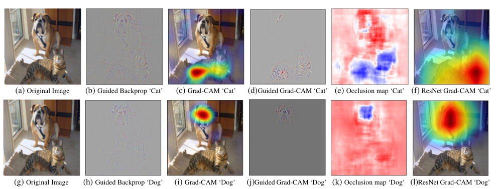

# Image Classifier with Class Activation Maps

This project explores convolutional neural-network classifiers and visualizes which regions in an image influence a model’s prediction.

## What it contains

- Training or loading a PyTorch image classifier
- Running forward passes and extracting the predicted class
- Computing a class activation map (CAM) from convolutional feature maps
- Overlaying the CAM on the source image to produce a heatmap
- Comparing the model’s visual evidence with the corresponding class label

### Grad-CAM
Example showing gradient CAM for a ResNet implementation. Grad-CAM is class discriminative and does not require modification of the model architecture: https://arxiv.org/pdf/1610.02391

- We use the img2grad_cam function (classifier/src/malaria/cam/grad_cam.py) to expose the gradient of the last convolution in order to calculate the heat map using the following formula:

$$
L^{c}_{\text{Grad-CAM}} = \mathrm{ReLU}\left( \underbrace{\sum_{k} \alpha^{c}_{k} A^{k}}_{\text{linear combination}} \right)
$$

Here we calculate $\alpha^{c}_{k}$, the weight attributed to each activation map $A^k$ for a specific class $c$, using the following formula:

$$
\alpha^{c}_{k} = \overbrace{\frac{1}{Z} \sum_{i} \sum_{j}}^{\text{global average pooling}} \underbrace{\frac{\partial y^{c}}{\partial A^{k}_{ij}}}_{\text{gradients via backprop}}
$$

Notice that $$A^{k}_{ij}$$ is the feature map containing activations $$A^{k}$$ of a convolution layer (6th one in our case). The choice of the last convolutional layer is deliberate here due to the fact that it has the widest receptive field, We find that Grad-CAM maps become worse as we move to earlier convolutional layers, as they have smaller receptive fields and only focus on less semantic local features. 

## Concept

A class activation map highlights the spatial locations that contribute most strongly to a particular class score. A CAM is typically produced by weighting the final convolutional feature maps and reducing them to a two-dimensional heatmap. Interpreting the heatmap does not prove that a model understands an object, but it provides a useful qualitative view of where the network is looking.

## Typical workflow

1. Configure the dataset and PyTorch data loaders.
2. Load or train a pretrained convolutional neural network.
3. Pass an image through the network.
4. Select the target class, usually the predicted class.
5. Capture the activations and gradients or other class-discriminative weights from the relevant convolutional layer.
6. Combine the feature maps into a heatmap and it upscale it to match the input image.
7. Overlay the heatmap on the original image for inspection.

## Requirements

A Python environment with PyTorch, torchvision, NumPy, and a plotting/image package such as Matplotlib and OpenCV or PIL is typically required. A GPU can speed up training and inference but is not required for a few test images.

## Usage

clone the repository and setup a uv environment
 - git clone https://github.com/AlanJudi/malaria-classifier.git
 - curl -LsSf https://astral.sh/uv/install.sh | sh
 - uv venv --python==3.11 
 - source .venv/bin/activate
 - uv run train

Obtaining data from kaggle (download kaggle cli and load/unzip the data)
 - kaggle datasets download -d iarunava/cell-images-for-detecting-malaria
 - unzip -qq cell-images-for-detecting-malaria.zip

## Notes

- Heatmaps are visual explanations, not a complete or guaranteed description of model behavior.
- The selected convolutional layer affects the spatial detail and receptive-field coverage of the visualization.
- Preprocessing and normalization should match those used by the pretrained model.
